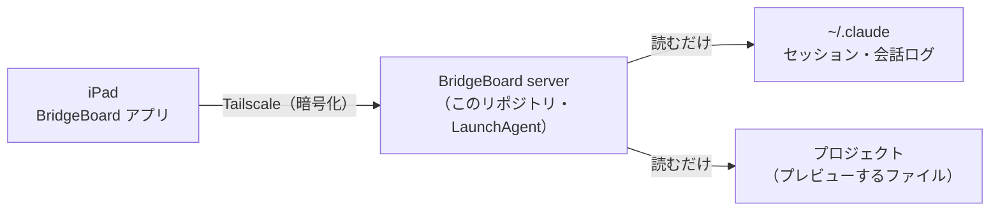

# BridgeBoard server

[English](README.md)（こちらが正本です）

macOS 用の、**読むだけ**の小さなサーバーです。Claude Code を動かしている Mac で動き、自分の [Tailscale](https://tailscale.com) ネットワーク越しに、**BridgeBoard の iPad アプリ**へ、起動中の Claude Code のセッションの一覧・会話・プロジェクトのファイルのプレビューを渡します。

- **読むだけ。** Claude Code のセッション・会話ログ・プロジェクトのファイルには書き込みません。受けるのは `GET` だけです（`HEAD` を含め、ほかの方法は `405`）。例外は、一度きりの組む要求（`POST /v1/pair`）1つです。
- **tailnet の中だけ。** Mac の Tailscale のアドレス（100.64.0.0/10）でだけ待ち受けます。インターネットには出ず、自分で更新もしません。
- **Python 3.9 の標準ライブラリだけ。** pip のパッケージは使いません。同梱は `vendor/qrcodegen.py`（Project Nayuki、MIT）1つで、組むための QR を描きます。
- **鍵は端末ごと。** 組んだ iPad 1台ごとに別の鍵です。Mac は鍵のハッシュだけを持ち、端末はいつでも取り消せます。



BridgeBoard は OneMore Lab の独立したプロジェクトです。**Anthropic とは無関係で、Anthropic の承認や後援を受けたものではありません。** 「Claude」「Claude Code」は Anthropic, PBC の商標、「Tailscale」は Tailscale Inc. の商標です。

## 必要なもの

- Xcode のコマンドラインツール（`xcode-select --install`）が入った Mac。`install.sh --check` は、ほかの Python 3.9 以上（Homebrew など）があっても、いつもこれを求めます。サーバーが `git` を使い、ツールが無いと `git` も `/usr/bin/python3` も殻だけだからです。
- Mac と iPad の Tailscale（同じ tailnet にサインイン済み）。その tailnet で **MagicDNS が有効**であること（[Tailscale の管理画面](https://login.tailscale.com/admin/dns)の DNS のページ）。組むための QR には、この Mac の MagicDNS の名前が入っていなければなりません（アプリは名前のない QR を断ります）。そのため `bbctl pair` と `install.sh --check` が名前を求めます。
- Mac の Claude Code。セッションは Remote Control で動かしたもの。サーバーが一覧に出すのは Remote Control の ID があるセッションだけで、iPad はそれを claude.ai で開きます。
- iPad の BridgeBoard アプリ。

## 入れる

いちばん簡単なのは、準備のプロンプトです。Mac の好きなフォルダで Claude Code を開き、[`setup/prompt.ja.md`](setup/prompt.ja.md)（アプリにも同じ文が出ます）の中身を貼って、iPad のことを聞かれたら答えてください。Claude Code が決まったタグのリリースを取得し、確かめ、サーバーを入れ、組むところまで進めます。プロンプトには、スクリプトを書き換えない・`sudo` を使わない・データのフォルダを読まない・QR の画像を開かない、と書いてあります。

自分でやるときは、ターミナルで（タグは欲しいリリースのものに）：

```bash
git clone --depth 1 --branch v0.1.2 https://github.com/OneMoreLab-jp/bridgeboard-server.git
cd bridgeboard-server
git rev-parse HEAD          # GitHub のタグと見比べる
./install.sh --check        # 何も変えない
./install.sh                # サーバーを入れて起動する
"$HOME/Library/Application Support/BridgeBoard/current/bbctl" pair
```

取得したフォルダは、あとで消して構いません。更新するときは、新しいタグを取得してもう一度 `./install.sh` を実行します。動いているサーバーを入れ替え、組んだ端末と `config.json` はそのままです。古い版は `versions/` に残るので、戻すときはデータのフォルダの中で `ln -sfn versions/<古い版> current` を実行し、`launchctl kickstart -k gui/$(id -u)/jp.onemorelab.bridgeboard.server` で立て直します。

### `install.sh --check`

項目ごとに `ok`・`warn`・`fail` の行を1つずつ出し、あとに詳しい内容か理由が続きます。`fail` が1つでもあれば終了コードは 3 です。`warn` は失敗ではありません。

| 項目 | 確かめること |
|---|---|
| `clt` | `xcode-select -p` が通る（コマンドラインツールが入っている） |
| `python>=3.9` | launchd の下で動く Python 3.9 以上が見つかる。探す順は `config.json` の `python`、`/usr/bin/python3`（コマンドラインツールがあるときだけ）、`PATH`、`/opt/homebrew/bin`、`/usr/local/bin`。候補はそれぞれ、launchd がサーバーを動かすのと同じ形、つまり `PATH=/usr/bin:/bin:/usr/sbin:/sbin` だけを持つ空の環境で動かして確かめます。それ以上を必要とする Python（pyenv の shim など）と、仮想環境の中の Python は飛ばします。`config.json` の `python` がこれに通らなければ使わず、`install.sh` が選び直したものを `config.json` に書き戻します |
| `tailscale` | `tailscale` コマンドが見つかり（`config.json`、`PATH`、Homebrew、`/Applications/Tailscale.app`、`~/Applications/Tailscale.app`）、`BackendState` が `Running` |
| `magicdns` | `tailscale status --json` が、tailnet で MagicDNS が有効（`CurrentTailnet.MagicDNSEnabled`）で、この Mac に DNS の名前がある（`Self.DNSName`）と答える。`tailscale` の項目が失敗しているときは `warn ... not checked` |
| `ports` | 2つのポート（既定は 8772 と 8773）が空いている。このサーバー自身の LaunchAgent が入っているときは、使用中なのが当然なので通す |
| `claude-sessions` | `~/.claude/sessions` がある |
| `remote-control` | Remote Control の ID がある生きたセッションの数。0 なら `warn` |

`./install.sh` 本体は、この版を `~/Library/Application Support/BridgeBoard/versions/<版>/` に写し、`current` をそこへ付け替え、`config.json` を書き（すでにある値は残す）、LaunchAgent `jp.onemorelab.bridgeboard.server` を書いて読み込み、`/v1/health` が答えるまで最大15秒待ちます。新しいサーバーが答えないとき（同じポートの古いサーバーが答えても数えません）は、記録の末尾10行を出して終了コード 4 で終わります。秘密は作らず、出しもしません。オプションは `--show-gitignored` と `--launcher-root <path>:<depth>` です（「設定する」を見てください）。

## iPad を組む

```bash
"$HOME/Library/Application Support/BridgeBoard/current/bbctl" pair
```

1. `bbctl pair` は、まず2つを確かめます。どちらかがだめなら、符号を作る前に直し方を出して、終了コード 1 で終わります。確かめるのは、Tailscale がこの Mac の MagicDNS の名前を答えることと、QR に入れるアドレスとポートで、サーバーが `/v1/health` に答えることです。そのあと、**5分**で切れる一度きりの組む符号を作り、データのフォルダの下に QR の画像として書いて、Mac の画面に開きます。QR に入っているのは、サーバーの名前とアドレス・ポート・その一度きりの符号です。鍵は入っていません。（`--host` で名前を手で決められますが、この Mac 自身の MagicDNS の名前でなければなりません。サーバーはほかの名前に `421` を返すためです。Tailscale の答えと違うと、`bbctl pair` が警告します。）
2. BridgeBoard アプリで、画面の QR を読みます。アプリは符号と端末の名前を Tailscale 越しにサーバーへ送り、サーバーはその iPad だけの鍵を返します。アプリは鍵をキーチェーンに保存します。
3. `bbctl pair` は `paired: <端末の名前>`・`expired`・`replaced: ...`（別の `bbctl pair` が始まって、この符号が使えなくなった）のどれかを出して、画像を消します。**組めたら QR の窓は閉じて構いません。** 符号は一度きりで、5分で切れ、画像のファイルはもうありません。人が端末で走らせたときは、QR を端末にも描きます。

AI アシスタントが `bbctl pair` を走らせたときは、出力に符号は入りません（`QR image: <パス>` と注意の1行だけ）。AI アシスタントはその画像を開かない・読まないでください。中の符号が会話と claude.ai に入ってしまうためです。画像は人が開いて、iPad で読みます。

```bash
"$HOME/Library/Application Support/BridgeBoard/current/bbctl" devices       # 組んだ端末の一覧：id・名前・組んだ日時・最後に使った日時（鍵もハッシュも出さない）
"$HOME/Library/Application Support/BridgeBoard/current/bbctl" revoke <id>   # 動いているサーバーが、その端末をすぐ断る
```

（`bbctl` は `PATH` に入っていません。データのフォルダの中の起動用スクリプトです。）組む口は、同じアドレスから1分に5回、全体で1分に30回までで、失敗しても理由は返しません。

## 設定する

設定は `~/Library/Application Support/BridgeBoard/config.json` にあります。`install.sh` が作り、すでにある値は残します。サーバーは起動のときにだけ読むので、書き換えたら `launchctl kickstart -k gui/$(id -u)/jp.onemorelab.bridgeboard.server` で立て直してください。無い項目は既定の値です。正しくない値は無視され、記録に項目の名前だけが残ります（値は残しません）。

| 項目 | 既定 | 意味 |
|---|---|---|
| `apiPort` | `8772` | API（JSON・知らせの流れ・組む口）のポート |
| `filePort` | `8773` | プレビュー用のファイル口のポート。API とオリジンを分けるため、別の口で、`apiPort` と違う番号にしてください。`config.json` で両方が同じ番号なら、サーバーは両方を無視して記録し、8772 と 8773 に戻して起動します。`listserver.py` のフラグ `--api-port`・`--file-port` で最後の値が同じになったときだけは、記録して終了コード 2 で終わります |
| `claudeDir` | `"~/.claude"` | Claude Code が `sessions/`・`projects/` を置く場所。Claude Code に `CLAUDE_CONFIG_DIR` を設定しているなら、同じフォルダを書きます |
| `showGitIgnored` | `false` | `true` なら、git が無視しているファイルも見せます。既定では、一覧にも出さず中身も返しません。秘密は `.gitignore` に書かれていることが多いためです |
| `previewExternal` | `true` | `true` なら、プレビューする HTML がインターネットの画像・フォント・スクリプトを読めます。そのため、悪意のあるページが自分のプロジェクトから読んだ値を外へ送ることもできます。`false` は、プロジェクトの外からの画像・フォント・スクリプトの読み込みを止めます（資源の予告は確かめていません）。「HTML のプレビューで残る道」を見てください |
| `launcherRoots` | `[]` | `{"path": "~/Projects", "depth": 2}` の並び。深さ 1 は `<path>/<フォルダ>`、深さ 2 は `<path>/<分類>/<フォルダ>` をプロジェクトとして並べます。空なら、Claude Code を使ったことのあるフォルダ（会話ログから拾う）です |
| `tailscale` | `null` | `tailscale` コマンドのパス。`null` なら探します。`install.sh` が見つけたものを書きます |
| `python` | `null` | `install.sh` が選んだ Python。使うのは `install.sh` と `bbctl` だけです |

`install.sh --show-gitignored` は `showGitIgnored` を `true` にします。`--launcher-root <path>:<depth>` を1回以上付けると、`launcherRoots` の並び**全体をそれらに置き換えます**（`<depth>` は 1 か 2、`<path>` は絶対パスか `~/` で始まるパス）。付けなければ、並びはそのままです。`config.json` が信用できないとき（リンク、他人のもの、グループ・その他が書き込める、64 KiB を超える、JSON の辞書でない）は、サーバーはそのファイルを全部無視して既定の値を使います。ただし `previewExternal` だけは、厳しい側の `false` になります。`previewExternal` が `true`・`false` でない値（`"false"` という文字列など）のときも、`false` として扱います。`install.sh` はそういうファイルには触らず、直すよう伝えて止まります。

データのフォルダは `~/Library/Application Support/BridgeBoard/`（権限 700）で、`config.json`・`secret`・`devices.json`（端末の鍵のハッシュだけ）・`versions/`・`current` が入ります。記録は `~/Library/Logs/BridgeBoard/listserver.log`（1 MB で回し、古い2本を残す）です。記録には、鍵・組む符号・ファイルの中身・会話の本文を書きません。

## 見せるもの、決して見せないもの

見せるもの：起動中の Claude Code のセッション（Remote Control の ID があるもの）とそのプロジェクト。会話（Claude Code の会話ログから描く）。プロジェクトのフォルダとファイル（1段ずつ）と、Markdown・HTML・画像のプレビュー。データのフォルダの `usage.json` にある使用率（Claude Code のステータスラインのスクリプトがそのファイルを書いたとき。そのスクリプトはこのリポジトリの外にあり、このリポジトリには含まれません。ファイルが無ければ `/v1/usage` は使えないと答えます）。変化をアプリへ知らせる流れ。

決して見せないもの：

- ホームの外（`/tmp`・`/Volumes` など）、ホームそのもの、`~/Library`（iCloud のアプリごとの入れ物の中を除く）、`~/.claude`、サーバー自身のフォルダ。そういう場所のプロジェクトは一覧には出ますが、ファイルは返しません。**見える制限です：ホームの外のプロジェクトには、ファイルのプレビューがありません。**
- ホームより下で、パスの途中に `.` で始まる名前があるフォルダ。
- 秘密に使われやすい名前のファイル：`.` で始まるもの、`.env*`、`id_rsa*`、`id_ed25519*`、`id_ecdsa*`、`id_dsa*`、`*.pem`、`*.p12`、`*.pfx`、`*.p8`（`AuthKey_*.p8` などの App Store Connect の鍵）、`*.keystore`、`*.jks`、`*.ppk`、`*.kdbx`、`*.keychain-db`、`*.tfstate`、`*.tfvars`、`*.mobileprovision`、`*.sqlite`、`*.db`、`credentials`、`credentials.json`、`master.key`、`kubeconfig`、`keystore.properties`、`service-account*.json`、`secrets*`、`secret.*` など。Keynote の `.key` は、`.key` だけでは秘密と言えないので見せます。
- git が無視しているファイル（`showGitIgnored` が `true` のときを除く）。`git check-ignore` で判定するので、git のリポジトリの中だけに効きます。
- 組む符号・端末の鍵・サーバーの `secret`。

プロジェクトは、セッションが動いているフォルダか、その git リポジトリの一番上です。git リポジトリの一番上がホームそのものか、それより上なら、代わりにセッションの作業フォルダを使います。そのフォルダにはホームのリポジトリの .gitignore が効かないので、そこで無視しているファイルも見えることがあります。秘密のファイルの名前の決まりは効きます。git の答えが作業フォルダより上を指したとき（`core.worktree` の細工など）は信用しないので、プロジェクトが親のフォルダまで広がることはありません。

## セキュリティの覚え書き

- **ネットワーク。** Mac の Tailscale の IPv4 アドレスでだけ待ち受けます（試験では `127.0.0.1`）。`0.0.0.0` にはなりません。`Host` の見出しを確かめ、Tailscale の IP・`localhost`/`127.0.0.1`・この Mac の MagicDNS の名前だけを受けます（違えば `421`。DNS リバインディング対策）。通信は tailnet の中の http で、Tailscale が暗号化します。Tailscale のアドレスが変わっても、Tailscale が止まっていても、サーバーは動いたまま、自分で待ち受け直します。
- **認証の前。** 接続の数（全体・アドレスごと）、要求の行と見出しを待つ時間、見出しの大きさに上限があり、要求を終えない相手でサーバーを固められません。`/v1/health` は鍵が要らず、`{"ok": true, "apiVersion": 3}` だけを返します。
- **鍵。** API の要求は、端末の鍵（`Authorization: Bearer ...`）を付けます。ファイルは2つ目のポートで、端末ごと・プロジェクトのフォルダごとに違うクッキー（Mac の `secret` から作る）で渡します。端末を取り消せば、そのクッキーも使えなくなります。プロジェクトのフォルダの ID には `secret` を混ぜてあり、パスから計算できません。
- **ファイル口。** どの応答にも `X-Content-Type-Options: nosniff` と `Content-Security-Policy` を付けます。プレビューする HTML は、独立した（opaque な）オリジンの sandbox の中で動くので、その JavaScript は `fetch` で同じプロジェクトのほかのファイルを読めず、クッキーも読めず、API も呼べません。SVG と XML はスクリプトなしで返します。

### HTML のプレビューで残る道

CSP は全部の道を塞げません。**信用できない** HTML をプレビューすると、データが一部漏れることがあります。

**ページが読めるもの（どちらの設定でも）。** 同じプロジェクトの script（`.js`。CommonJS の `module.exports` のものも含みます。`.mjs` は `export` を含まないものだけ）を `<script src>` で読み込んだときに、script が出す値（変数や `module.exports` など）を読めます。同じプロジェクトの `.css` にあるカスタムプロパティ（`--x: 値`）の値も読めます。`fetch`・XHR・WebSocket・EventSource は、どちらの設定でも止まっています（`connect-src 'none'`）。

**読んだ値を外へ送る道。**

1. **既定の `previewExternal: true` では、1回の読み込みで足ります。** ページは、読んだ値をインターネットの画像・フォント・スクリプト1つの URL に入れて読み込むだけで、値を Mac の外へ出せます。既定にしたのは、作者が試した HTML の約半分がそういうもの（保存した論文の画像・Google Fonts・CDN のスクリプト）を読み込み、止めるとそのページが崩れるためです。**`previewExternal: false` にすると、サーバーはプロジェクトの外からの画像・フォント・スクリプトの読み込みを止めます。** ページが読み込めるのは自分のプロジェクトの中だけになります（`default-src 'self'`）。ただし、`dns-prefetch`・`preconnect` などの資源の予告は確かめていないので、そこからの漏れを否定はしません。
2. **どちらの設定でも、移動と WebRTC。** 外への移動（`location`・form・`window.open`）と WebRTC（STUN）の通信は、サーバーの CSP では止められません。止めるのはアプリの仕事です（別のオリジンへの移動を断る。プレビューで WebRTC を使えなくする）。サーバーでは代われません。

つまり、既定の設定では、悪意のある HTML は、同じプロジェクトの script が出す値と CSS のカスタムプロパティの値を外へ送れます。`false` にすればサーバーは外への読み込みを止めますが（資源の予告は確かめていません）、残る道（移動・WebRTC）はアプリ次第です。script や CSS のカスタムプロパティに秘密を持たせているプロジェクトでは、信用できない HTML をプレビューしないでください。ファイルを開くのは、アプリでの明示的な操作です。

**読めないもの：** `.json`・`.env`・鍵のファイル・ほかの種類のファイル・クッキー・API。ほかのプロジェクトのファイルも読めませんが、それは、プロジェクトを切り替えるときにアプリが前のプロジェクトのクッキーを消すことが条件です（クッキーはプロジェクトごとで、2つのプロジェクトのクッキーを同時に持つページは両方を読めます）。

### `/v1/diagnostics`

端末の鍵を付けた `GET /v1/diagnostics` は、Claude Code のデータの形が変わったことをアプリに知らせるための数を返します（一覧が黙って空になるのを防ぎます）。パス・ID・本文は含みません。

- `transcripts.unknownTypes`・`transcripts.unknownTypeNames`・`transcripts.unknownOriginKinds` は、普段は `0`（名前の並びは `[]`）です。**0 でないときは、Claude Code の会話ログの形が変わった疑いがあり**、このサーバーの更新が要ります。`transcripts.unreadableLines` は、読めなかった会話ログの行の数です。
- `sessions` は `~/.claude/sessions` のファイルを数えたものです。`malformed` と `procMismatch` は 0 に近いはずで、`dead`（終わったセッション）と `noBridge`（Remote Control を使わないセッション）は普通に増えます。一覧が空なのに `noBridge` が多いときは、Remote Control の ID の名前が変わったのかもしれません。
- ほかに、`version`・`apiVersion`・`startedAt`、`sessions/` に見えた Claude Code の版 `claudeCodeVersions`、`gitignore`（`git` が使えるか・`showIgnored` が入っているか）、`tcc.blockedRoots`（macOS がサーバーに読ませないプロジェクトの数）、`previewExternal` があります。

## 既知の制限

- **Documents・デスクトップ・iCloud Drive。** macOS（TCC）は、許可しない限り、バックグラウンドのプログラムに `~/Documents`・`~/Desktop`・iCloud Drive の下のプロジェクトを読ませません。そういうプロジェクトは一覧には出ますが、ファイルは読めないと返ります（`/v1/diagnostics` の `tcc.blockedRoots` がその数です）。サーバーは、Python にそれらのフォルダへの許可を与えるよう案内しません。プレビューしたいプロジェクトは、ホームの中のほかの場所（たとえば `~/Projects`）に置いてください。
- macOS だけです（Apple Silicon と Intel）。Claude Code のセッションのファイルは公開された形式ではないので、Claude Code の更新で一覧が壊れることがあります。上の診断は、それに気づくためのものです。
- tailnet の中は http です（https ではありません）。Tailscale が通信を暗号化しますが、tailnet の中の端末なら2つのポートに届きます。端末の鍵がなければ、`/v1/health` を見るか、組む符号を試す以外は何もできません。

## 困ったとき

- `bbctl pair` が、MagicDNS の名前を読めない・MagicDNS が無効だと言う：[Tailscale の管理画面](https://login.tailscale.com/admin/dns)（DNS のページ）で MagicDNS を有効にして、もう一度実行します。何も作っていません。`install.sh --check` は同じことを `magicdns` として知らせます。
- `bbctl pair` が、サーバーが `/v1/health` に答えないと言う：サーバーが動いていないか、`config.json` と違うポートで待ち受けています（`listserver.log` を見る、`./install.sh --check` を走らせる、または `--api-port` を渡す）。
- iPad にセッションが出ない：`./install.sh --check` をもう一度走らせて（`remote-control` を見る）、`~/Library/Logs/BridgeBoard/listserver.log` を見ます。
- `install.sh` が 4 で終わる：記録の末尾が出ています。「Cannot listen」はほかのプログラムがポートを使っているということなので、`config.json` の `apiPort`/`filePort` を変えます。
- `install.sh` が 1 で終わり、古いサーバーが止まらなかったと言う：前に入れたサーバーがまだ動いていて、ファイルを使っています。`launchctl bootout gui/$(id -u)/jp.onemorelab.bridgeboard.server` で止めてから、もう一度 `install.sh` を実行します。
- Tailscale を再起動した・アドレスが変わった：何もしなくて構いません。15秒ほどで、サーバーが待ち受け直します。

## 外す

```bash
"$HOME/Library/Application Support/BridgeBoard/current/uninstall.sh"            # サーバーを止め、LaunchAgent を消す。データと記録は残す
"$HOME/Library/Application Support/BridgeBoard/current/uninstall.sh" --purge    # データのフォルダと記録も消す（組んだ iPad は組み直し）
```

ほかのもの（Tailscale・Claude Code・プロジェクト）には触れません。

## 試験

```bash
python3 -m unittest discover -s tests -t .
```

試験は、本物の `~/Library`・本物の `launchctl`・ポート 8772 と 8773 には触れません。

## ライセンス

MIT（[LICENSE](LICENSE)）。`vendor/qrcodegen.py` は Project Nayuki の作で、こちらも MIT です（[vendor/README.md](vendor/README.md)）。
