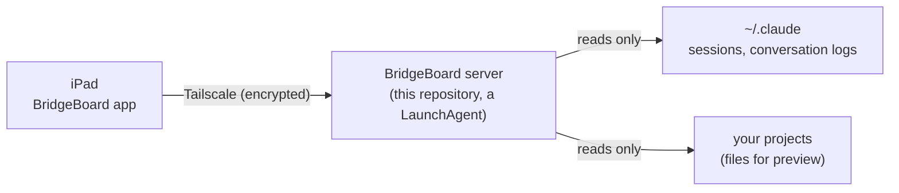

# BridgeBoard server

[日本語](README.ja.md)

A small, **read-only** server for macOS. It runs on the Mac where Claude Code works. Over your own [Tailscale](https://tailscale.com) network it lets the **BridgeBoard iPad app** list your running Claude Code sessions, read their conversations, and preview the files of their projects.

- **Read-only.** It never writes to Claude Code's sessions or conversation logs, or to your projects. It only answers `GET` requests (`HEAD` and every other method get `405`); the one exception is the one-time pairing request (`POST /v1/pair`).
- **Inside your tailnet only.** It listens on the Mac's Tailscale address (100.64.0.0/10) and nowhere else. It never connects to the internet and never updates itself.
- **Python 3.9 standard library only.** No pip packages. One bundled file, `vendor/qrcodegen.py` (MIT, Project Nayuki), draws the pairing QR code.
- **One key per device.** Every paired iPad has its own key. The Mac stores only a hash of it, and you can revoke a device at any time.



BridgeBoard is an independent project by OneMore Lab. **It is not affiliated with, endorsed by, or sponsored by Anthropic.** "Claude" and "Claude Code" are trademarks of Anthropic, PBC. "Tailscale" is a trademark of Tailscale Inc.

## What you need

- A Mac with the Xcode Command Line Tools (`xcode-select --install`). `install.sh --check` always requires them, even if you have another Python 3.9 or newer (for example from Homebrew), because the server runs `git`, and without the tools `git` and `/usr/bin/python3` are only stubs.
- Tailscale on the Mac and on the iPad, signed in to the same tailnet, with **MagicDNS turned on** for that tailnet (the DNS page of the [Tailscale admin console](https://login.tailscale.com/admin/dns)). The pairing QR code must carry this Mac's MagicDNS name (the app refuses a QR code without one), so `bbctl pair` and `install.sh --check` ask for it.
- Claude Code on the Mac, with sessions started with Remote Control. The server lists only sessions that have a Remote Control id; the iPad opens them on claude.ai.
- The BridgeBoard app on the iPad.

## Install

The easiest way is the setup prompt. Open Claude Code in any folder on the Mac, paste the contents of [`setup/prompt.en.md`](setup/prompt.en.md) (the app shows the same text), and answer when it asks about the iPad. Claude Code downloads the tagged release, runs the checks, installs the server and starts the pairing. The prompt tells it not to edit the scripts, not to use `sudo`, not to read the data folder, and not to open the QR image.

Or do it yourself in Terminal (use the tag of the release you want):

```bash
git clone --depth 1 --branch v0.1.0 https://github.com/OneMoreLab-jp/bridgeboard-server.git
cd bridgeboard-server
git rev-parse HEAD          # compare with the tag on GitHub
./install.sh --check        # changes nothing
./install.sh                # installs and starts the server
"$HOME/Library/Application Support/BridgeBoard/current/bbctl" pair
```

You can delete the cloned folder afterwards. To upgrade, clone the newer tag and run `./install.sh` again: it replaces the running server, and your paired devices and `config.json` stay. Older versions stay in `versions/`, so to go back run `ln -sfn versions/<old version> current` inside the data folder and then `launchctl kickstart -k gui/$(id -u)/jp.onemorelab.bridgeboard.server`.

### `install.sh --check`

One line per item, `ok`, `warn` or `fail`, followed by details or a reason. The exit status is 3 if any item is `fail`; a `warn` does not fail.

| Item | What it checks |
|---|---|
| `clt` | `xcode-select -p` works (the Command Line Tools are installed) |
| `python>=3.9` | A Python 3.9 or newer that works under launchd is found. Looked at in this order: `python` in `config.json`, `PATH`, `/opt/homebrew/bin`, `/usr/local/bin`, and `/usr/bin/python3` (the last one only if the Command Line Tools are installed). Each candidate is run the way launchd runs the server, with an empty environment except `PATH=/usr/bin:/bin:/usr/sbin:/sbin`, so a Python that needs more than that (a pyenv shim, for example) is skipped, and so is a Python inside a virtual environment. A `python` in `config.json` that fails this is not used; `install.sh` writes the one it chose back into `config.json` |
| `tailscale` | The `tailscale` command is found (`config.json`, `PATH`, Homebrew, `/Applications/Tailscale.app`, `~/Applications/Tailscale.app`) and its `BackendState` is `Running` |
| `magicdns` | `tailscale status --json` says MagicDNS is enabled for the tailnet (`CurrentTailnet.MagicDNSEnabled`) and gives this Mac a DNS name (`Self.DNSName`). It is `warn ... not checked` when the `tailscale` item failed |
| `ports` | The two ports (8772 and 8773 by default) are free. If this server's own LaunchAgent is loaded, they are expected to be in use |
| `claude-sessions` | `~/.claude/sessions` exists |
| `remote-control` | Counts live sessions that have a Remote Control id. `warn` if there are none |

`./install.sh` itself copies this version to `~/Library/Application Support/BridgeBoard/versions/<version>/`, points `current` at it, writes `config.json` (values already there are kept), writes and loads the LaunchAgent `jp.onemorelab.bridgeboard.server`, and waits up to 15 seconds for `/v1/health` to answer. If the new server does not answer (an older server on the same port does not count), it prints the last 10 lines of the log and exits with status 4. It creates no secret and prints none. Its options are `--show-gitignored` and `--launcher-root <path>:<depth>` (see "Configure").

## Pair an iPad

```bash
"$HOME/Library/Application Support/BridgeBoard/current/bbctl" pair
```

1. `bbctl pair` first checks two things. If either fails it says how to fix it and exits with status 1 before it makes any code: Tailscale must report a MagicDNS name for this Mac, and the server must answer `/v1/health` at the address and port the QR code will hold. Then it makes a one-time pairing code that is valid for **five minutes**, writes it into a QR image under the data folder, and opens the image on the Mac's screen. The QR code holds the name and address of the server, the ports and that one-time code. It never holds a key. (`--host` sets the name by hand. It must be this Mac's own MagicDNS name, because the server answers `421` to any other name; `bbctl pair` warns if it differs from what Tailscale reports.)
2. In the BridgeBoard app, scan the QR code on the screen. The app sends the code and its name to the server over Tailscale, and the server answers with a key made for that iPad alone. The app keeps it in the keychain.
3. `bbctl pair` prints `paired: <device name>`, `expired`, or `replaced: ...` (another `bbctl pair` was started, so this code no longer works), and deletes the image. **You may close the QR window once the iPad is paired.** The code works once, expires after five minutes, and the image file is already gone. When a person runs the command in a terminal, the QR code is also drawn in the terminal.

If an AI assistant runs `bbctl pair`, the output holds no code (only `QR image: <path>` and a note), and the assistant must not open or read that image: the code in it would end up in the conversation and in claude.ai. A person opens the image and scans it with the iPad.

```bash
"$HOME/Library/Application Support/BridgeBoard/current/bbctl" devices       # paired devices: id, name, created, last seen (no keys, no hashes)
"$HOME/Library/Application Support/BridgeBoard/current/bbctl" revoke <id>   # the running server stops accepting that device at once
```

(`bbctl` is not on your `PATH`; it is the launcher in the data folder.) The pairing endpoint accepts 5 attempts per minute from one address and 30 per minute in total, and a failed attempt does not say why it failed.

## Configure

Settings live in `~/Library/Application Support/BridgeBoard/config.json`. `install.sh` creates it and keeps any values already in it. The server reads it only when it starts, so after editing run `launchctl kickstart -k gui/$(id -u)/jp.onemorelab.bridgeboard.server`. A missing key means its default. A wrong value is ignored and noted in the log by key name (never by value).

| Key | Default | Meaning |
|---|---|---|
| `apiPort` | `8772` | Port of the API (JSON, event stream, pairing) |
| `filePort` | `8773` | Port of the file server used for previews. It is a different origin from the API on purpose, so it must differ from `apiPort`. If `config.json` gives the same number for both, the server ignores both, notes it in the log and uses 8772 and 8773. Only the command-line flags `--api-port` and `--file-port` of `listserver.py` can still make the two equal; the server then logs an error and exits with status 2 |
| `claudeDir` | `"~/.claude"` | Where Claude Code keeps `sessions/` and `projects/`. If you set `CLAUDE_CONFIG_DIR` for Claude Code, put the same folder here |
| `showGitIgnored` | `false` | `true` also shows files that git ignores. By default they are neither listed nor served, because secrets are usually in `.gitignore` |
| `previewExternal` | `true` | `true` lets an HTML file you preview load images, fonts and scripts from the internet; that also lets a malicious page send out what it read from its own project. `false` blocks image, font and script loads from outside the project (resource hints are not verified). See "What stays possible when you preview an HTML file" |
| `launcherRoots` | `[]` | A list of `{"path": "~/Projects", "depth": 2}`. Depth 1 lists `<path>/<folder>` as projects, depth 2 lists `<path>/<category>/<folder>`. Empty means: the folders where Claude Code has been used (taken from its conversation logs) |
| `tailscale` | `null` | Path of the `tailscale` command. `null` means "look for it". `install.sh` writes what it found |
| `python` | `null` | The Python that `install.sh` chose. Only `install.sh` and `bbctl` use it |

`install.sh --show-gitignored` sets `showGitIgnored` to `true`. Giving `--launcher-root <path>:<depth>` one or more times **replaces** the whole `launcherRoots` list with those entries (`<depth>` is 1 or 2; `<path>` is absolute or starts with `~/`); without the option the list stays as it is. If `config.json` cannot be trusted (a link, owned by someone else, writable by group or others, larger than 64 KiB, or not a JSON object), the server ignores it completely and uses the defaults, except that `previewExternal` then becomes `false`, the stricter value. A `previewExternal` that is not `true` or `false` (for example the text `"false"`) is also treated as `false`. `install.sh` refuses to touch such a file and tells you to fix it.

The data folder is `~/Library/Application Support/BridgeBoard/` (mode 700). It holds `config.json`, `secret`, `devices.json` (hashes of device keys only), `versions/` and `current`. The log is `~/Library/Logs/BridgeBoard/listserver.log` (1 MB, two older copies kept). The log never contains keys, pairing codes, file contents or conversation text.

## What it shows, and what it never shows

It shows: the live Claude Code sessions (those with a Remote Control id) and their projects; each conversation, drawn from Claude Code's conversation log; the folders and files of a project, one level at a time, with a preview of Markdown, HTML and images; the usage figures in `usage.json` in the data folder, if a Claude Code status-line script writes that file (such a script lives outside this repository, which contains none; without the file `/v1/usage` says the figures are not available); and an event stream that tells the app when something changed.

It never shows:

- Anything outside your home folder (for example `/tmp` or `/Volumes`), the home folder itself, `~/Library` (except inside iCloud's app containers), `~/.claude`, and the server's own folders. A project in such a place is listed, but its files are not served. **This is a limit you can see: a project outside the home folder has no file preview.**
- Folders whose path below your home folder has a component starting with `.`.
- Files whose names usually mean a secret: dot-files, `.env*`, `id_rsa*`, `id_ed25519*`, `id_ecdsa*`, `id_dsa*`, `*.pem`, `*.p12`, `*.pfx`, `*.p8` (App Store Connect keys such as `AuthKey_*.p8`), `*.keystore`, `*.jks`, `*.ppk`, `*.kdbx`, `*.keychain-db`, `*.tfstate`, `*.tfvars`, `*.mobileprovision`, `*.sqlite`, `*.db`, `credentials`, `credentials.json`, `master.key`, `kubeconfig`, `keystore.properties`, `service-account*.json`, `secrets*`, `secret.*` and a few more. Keynote's `.key` files are shown, because `.key` alone does not mean a secret.
- Files that git ignores, unless `showGitIgnored` is `true`. This uses `git check-ignore`, so it applies only inside git repositories.
- Pairing codes, device keys and the server's `secret`.

A project is the folder where a session runs, or the top of its git repository. A git answer that points above the working folder (for example through `core.worktree`) is not trusted, so a project never grows to a parent folder.

## Security notes

- **Network.** The server listens only on the Mac's Tailscale IPv4 address (or on `127.0.0.1` in tests), never on `0.0.0.0`. It checks the `Host` header: only the Tailscale IP, `localhost`/`127.0.0.1` and the Mac's MagicDNS name are accepted (anything else gets `421`), which blocks DNS rebinding. Traffic is plain HTTP inside the tailnet, which Tailscale encrypts. If the Tailscale address changes or Tailscale is down, the server keeps running and listens again by itself.
- **Before a request is authenticated** the server limits the number of connections (in total and per address), the time it waits for the request line and headers, and the header size, so a client that never finishes a request cannot lock the server. `/v1/health` needs no key and says only `{"ok": true, "apiVersion": 3}`.
- **Keys.** Every API request carries the device's key (`Authorization: Bearer ...`). Files are served on the second port with a cookie that differs for every device and every project folder and is derived from the Mac's `secret`. Revoking a device cancels its cookies too. Project folder ids are salted with the `secret`, so they cannot be computed from a path.
- **The file port.** Every response carries `X-Content-Type-Options: nosniff` and a `Content-Security-Policy`. A previewed HTML file runs in a sandbox with its own opaque origin, so its JavaScript cannot read the project's other files with `fetch`, cannot read the cookie, and cannot call the API. SVG and XML are served without scripts.

### What stays possible when you preview an HTML file

A CSP cannot close every path. Previewing an HTML file **you do not trust** can still leak some data:

**What the page can read, in both modes.** The values that the scripts of its own project folder put out when the page loads them through `<script src>` (that includes `.js` files with CommonJS `module.exports`, and `.mjs` files that contain no `export`), and the values of the custom properties (`--x: value`) in the project's own `.css` files. `fetch`, XHR, WebSocket and EventSource are blocked in both modes (`connect-src 'none'`).

**How it can send what it read out.**

1. **With the default `previewExternal: true`, one request is enough.** The page puts the values it read into the URL of a single image, font or script that it loads from the internet, and the data has left the Mac. This is the default because about half of the HTML files the author tried load such resources (images of saved papers, Google Fonts, CDN scripts), and blocking them breaks those pages. **With `previewExternal: false` the server closes image, font and script loads from outside the project**: the page may load only from its own project (`default-src 'self'`). Resource hints (`dns-prefetch`, `preconnect` and the like) are not verified, so a leak through them is not ruled out.
2. **In both modes, navigation and WebRTC.** Navigating away (`location`, a form, `window.open`) and WebRTC (STUN) traffic cannot be stopped by the server's CSP. The app must stop them: refuse navigation to another origin, and switch WebRTC off in the preview. The server cannot do this for you.

So, with the default setting, a malicious HTML file can send out the values that the scripts and the CSS custom properties of its project expose; with `false` the server closes the loads (resource hints are not verified) and what remains (navigation, WebRTC) depends on the app. Do not preview HTML from a source you do not trust in a project whose scripts or CSS custom properties hold secrets. Opening a file is always an explicit action in the app.

**What it cannot read:** `.json`, `.env`, key files, other file types, the cookie, or the API. It cannot read the files of other projects either, as long as the app removes the previous project's cookie when you switch projects: the cookie is per project, and a page that holds the cookies of two projects at once could read both.

### `/v1/diagnostics`

With a device key, `GET /v1/diagnostics` returns counts that tell the app when Claude Code's data has changed shape, instead of the list silently going empty. It never contains paths, ids or text.

- `transcripts.unknownTypes`, `transcripts.unknownTypeNames` and `transcripts.unknownOriginKinds` are normally `0` (and `[]`). **If they are not 0, Claude Code's conversation-log format has probably changed** and this server needs an update. `transcripts.unreadableLines` counts log lines that could not be read.
- `sessions` counts the files in `~/.claude/sessions`: `malformed` and `procMismatch` should stay near 0; `dead` (finished sessions) and `noBridge` (sessions without Remote Control) grow normally. If the list is empty while `noBridge` is large, the name of the Remote Control id may have changed.
- Also: `version`, `apiVersion`, `startedAt`, the `claudeCodeVersions` seen in `sessions/`, `gitignore` (is `git` usable, is `showIgnored` on), `tcc.blockedRoots` (projects that macOS does not let the server read) and `previewExternal`.

## Known limits

- **Documents, Desktop and iCloud Drive.** macOS (TCC) does not let a background program read projects under `~/Documents`, `~/Desktop` or iCloud Drive unless you allow it. Such a project is listed, but its files are reported as not readable (`tcc.blockedRoots` in `/v1/diagnostics` counts them). The server does not ask you to give Python access to those folders. Keep the projects you want to preview elsewhere in your home folder, for example `~/Projects`.
- macOS only (Apple Silicon and Intel). Claude Code's session files are not a documented interface, so a Claude Code update can break the list; the diagnostics above exist to notice that.
- Plain HTTP inside the tailnet (no HTTPS). Tailscale encrypts the traffic, but any device on your tailnet can reach the two ports; without a device key it can do nothing there except ask `/v1/health` or try the pairing code.

## Troubleshooting

- `bbctl pair` says it could not read the MagicDNS name, or that MagicDNS is turned off: turn on MagicDNS in the [Tailscale admin console](https://login.tailscale.com/admin/dns) (DNS page), then run it again. Nothing was made. `install.sh --check` reports the same thing as `magicdns`.
- `bbctl pair` says the server did not answer at `/v1/health`: the server is not running, or it listens on other ports than `config.json` says (check `listserver.log`, run `./install.sh --check`, or pass `--api-port`).
- The iPad shows no sessions: run `./install.sh --check` again (look at `remote-control`), then look at `~/Library/Logs/BridgeBoard/listserver.log`.
- `install.sh` exits with 4: the last lines of the log are printed. "Cannot listen" means another program holds the port: change `apiPort`/`filePort` in `config.json`.
- `install.sh` exits with 1 and says the old server did not stop: a server from an earlier install is still running and keeps its files in use. Stop it (`launchctl bootout gui/$(id -u)/jp.onemorelab.bridgeboard.server`) and run `install.sh` again.
- Tailscale restarted or got a new address: nothing to do, the server listens again within about 15 seconds.

## Remove

```bash
"$HOME/Library/Application Support/BridgeBoard/current/uninstall.sh"            # stops the server and deletes the LaunchAgent; keeps data and logs
"$HOME/Library/Application Support/BridgeBoard/current/uninstall.sh" --purge    # also deletes the data folder and the logs (paired iPads must pair again)
```

Nothing else is touched: not Tailscale, not Claude Code, not your projects.

## Tests

```bash
python3 -m unittest discover -s tests -t .
```

The tests never touch the real `~/Library`, the real `launchctl`, or ports 8772 and 8773.

## License

MIT (see [LICENSE](LICENSE)). `vendor/qrcodegen.py` is by Project Nayuki, also MIT (see [vendor/README.md](vendor/README.md)).
